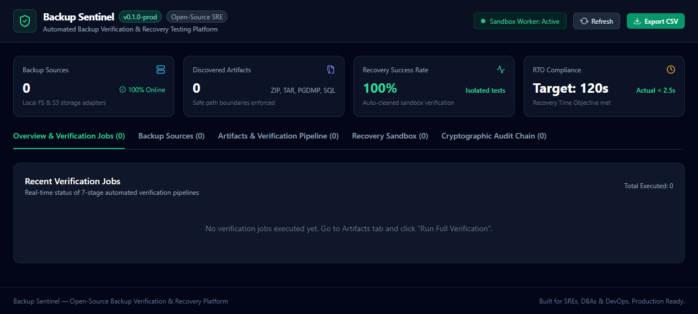
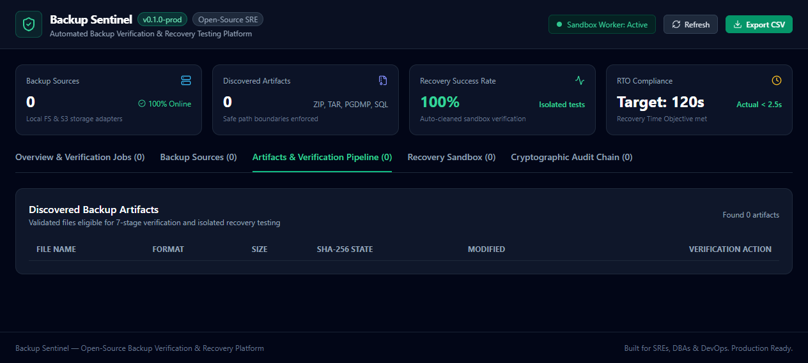
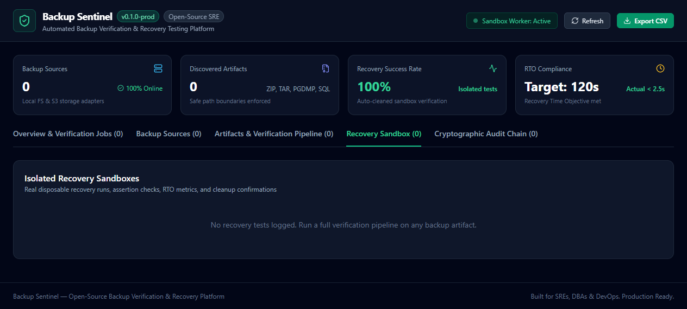
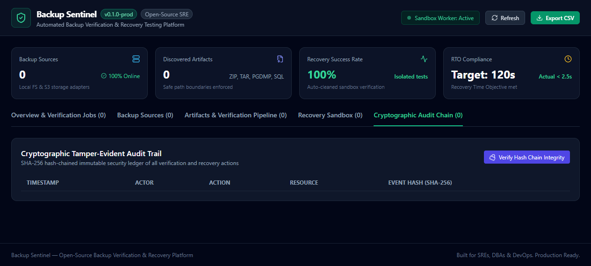
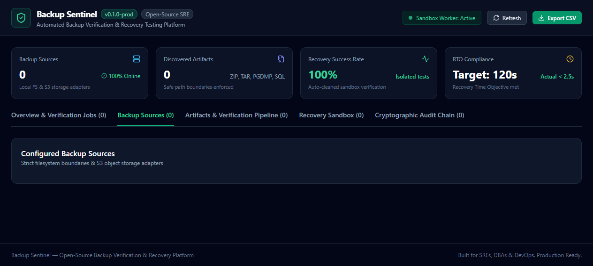
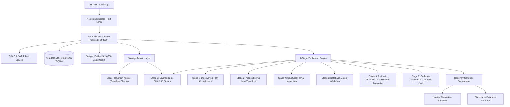

# Backup Sentinel

<div align="center">


**Automated Backup Verification & Recovery Testing Platform**

*A backup is not proven reliable until it has been successfully verified and its recovery process has been tested.*

</div>

---

## 📌 Overview

Traditional backup tools focus entirely on **creating** backups. **Backup Sentinel** focuses on independently **proving** that existing backups are readable, structurally sound, consistent, and genuinely recoverable before a disaster strikes.

Backup Sentinel answers five critical operational questions:
1. **Accessibility**: Does the backup artifact exist, and does it have a valid, non-zero payload?
2. **Cryptographic Integrity**: Does its cryptographic hash match verified reference records?
3. **Structural Validity**: Are archive headers, compression streams, and database schemas intact?
4. **Isolated Recoverability**: Can the backup actually be restored into an isolated disposable sandbox?
5. **Recovery Objectives**: Does actual measured restore duration satisfy your configured **RTO** (Recovery Time Objective) and **RPO** (Recovery Point Objective)?

---

## 📸 Platform Tour & Screenshots

### 1. Operations Overview & Verification Pipelines
Real-time operational health, RTO/RPO metrics, and active 7-stage verification execution.



### 2. Discovered Artifacts & Integrity Verification
Inspection table with cryptographic SHA-256 state tracking, archive format detection, and one-click verification triggers.



### 3. Isolated Recovery Testing Sandbox
Automated disposable sandbox verification runs, showing actual measured restore durations, RTO compliance evaluations, integrity assertions, and sandbox destruction confirmations.



### 4. Cryptographic Tamper-Evident Audit Trail
Append-only immutable audit ledger with SHA-256 hash chaining and on-demand mathematical verification of audit integrity.



### 5. Storage Adapters & Boundary Enforcement
Centralized management for local filesystem roots (with path containment checks) and S3 object storage adapters.



---

## ⚡ Key Capabilities

- **7-Stage Automated Verification Pipeline**:
  - `Stage 1`: Discovery & safe boundary path containment.
  - `Stage 2`: Storage accessibility and non-zero size validation.
  - `Stage 3`: Streaming SHA-256 cryptographic checksum calculation and comparison.
  - `Stage 4`: Format-specific structural verification (ZIP, TAR, PostgreSQL Custom `PGDMP`, SQL dumps).
  - `Stage 5`: Database schema and statement syntax inspection.
  - `Stage 6`: Policy evaluation (RTO target comparison, RPO estimation).
  - `Stage 7`: Evidence generation and immutable tamper-evident audit logging.
- **Isolated Disposable Recovery Sandbox**:
  - Automatically spins up disposable sandboxes with zero production access.
  - Tests real file extraction and table execution.
  - Protects against **Zip-Slip** path traversals (`../../etc/passwd`) and **decompression bombs**.
  - Guaranteed automatic cleanup and resource destruction via strict lifecycle hooks.
- **Tamper-Evident SHA-256 Audit Trail**:
  - Cryptographically hash-chained event ledger:
    `event_hash = SHA256(previous_hash | action | resource_type | resource_id | metadata | timestamp)`
  - Instant one-click chain integrity verification.
- **Role-Based Access Control (RBAC)**:
  - Granular permission boundaries for `admin`, `operator`, `auditor`, and `viewer` roles.
  - Secure bcrypt password hashing and stateless JWT bearer authentication.
- **Auditable Evidence & Exports**:
  - Downloadable compliance reports in CSV and JSON formats.

---

## 🏗️ Architecture



---

## 📦 Supported Formats

| Format | Extension | Verification Methodology | Recovery Test Execution |
| :--- | :--- | :--- | :--- |
| **ZIP Archives** | `.zip` | CRC-32 header check, zip-slip traversal protection, bomb ratio limit | Disposable directory extraction & file validation |
| **TAR Archives** | `.tar`, `.tar.gz`, `.tgz`, `.tar.bz2` | Stream header inspection, member path validation | Disposable directory extraction & file integrity checks |
| **PostgreSQL Custom** | `.dump`, `.pgdump` | Binary `PGDMP` magic header parsing, TOC inspection, version decoding | Isolated disposable sandbox verification |
| **Plain SQL Dumps** | `.sql` | DDL/DML statement scanning, dialect identification, transaction checks | Disposable in-memory/temp database schema execution |

---

## 🚀 Quickstart

### Option 1: Docker Compose (Recommended)

```bash
git clone https://github.com/0xyz-exe/backup-sentinel.git
cd backup-sentinel

# Start all services (Database, API, Web Dashboard)
docker-compose up -d

# Open the dashboard
open http://localhost:3000
```

### Option 2: Local Development Setup

#### 1. Backend (FastAPI + Python 3.12)
```bash
cd apps/api
uv venv --python 3.12 .venv
source .venv/bin/activate # On Windows: .venv\Scripts\activate
pip install -r requirements.txt email-validator

# Generate synthetic backup fixtures and seed default admin
python -m app.cli seed --dir "../../fixtures/synthetic-backups"

# Run automated tests
PYTHONPATH=. pytest -v

# Start backend server
uvicorn app.main:app --reload --port 8000
```

#### 2. Frontend (Next.js 14)
```bash
cd apps/web
pnpm install
pnpm run dev
# Dashboard runs on http://localhost:3000
```

---

## 🔒 Security Model

1. **Path Boundary Containment**: Storage adapters restrict scanning to configured `ALLOWED_STORAGE_ROOTS`. Symlink escapes and relative directory traversal (`..`) are strictly rejected.
2. **Decompression Bomb Protection**: Maximum decompression ratio thresholds (default: 100x) prevent resource exhaustion attacks.
3. **Isolated Sandboxing**: Recovery tests run inside disposable workspaces with restrictive resource quotas and zero production database access.
4. **Secret Redaction**: Passwords, encryption tokens, and cloud credentials are automatically sanitized from all logs and API responses.
5. **Append-Only Tamper-Evident Audit Chain**: Audit records are cryptographically linked using SHA-256 hashes to guarantee post-incident non-repudiation.

---

## 🧪 Automated Testing

Backup Sentinel comes with an automated test suite verifying security boundaries, failure detection, and recovery execution:

```bash
cd apps/api
PYTHONPATH=. pytest -v
```

Test coverage includes:
- [x] Checksum calculation, matching, and critical mismatch detection.
- [x] Path traversal attack rejection in ZIP archives (`../../etc/passwd`).
- [x] Corrupted archive header detection.
- [x] TAR decompression validation.
- [x] PostgreSQL custom dump `PGDMP` header and TOC validation.
- [x] Plain SQL dump validation and syntax scanning.
- [x] Isolated generic file recovery execution and automatic sandbox cleanup.
- [x] Disposable SQL database recovery test and RTO measurement.
- [x] Tamper-evident audit log cryptographic hash chain integrity.

---

## 📄 License

Licensed under the [Apache License, Version 2.0](LICENSE).
