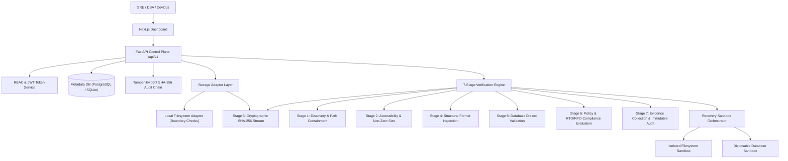

# Backup Sentinel — System Architecture

## Architectural Principles
1. **Local-First & Cloud-Agnostic**: Operates with zero required cloud dependencies.
2. **Strict Boundary Isolation**: Untrusted backup contents never execute against host or production resources.
3. **Auditable Evidence**: Checksums, durations, and assertion details are permanently logged in cryptographic audit chains.
4. **Automated Cleanup**: Disposable recovery sandboxes are guaranteed to be destroyed in `finally` execution blocks.
